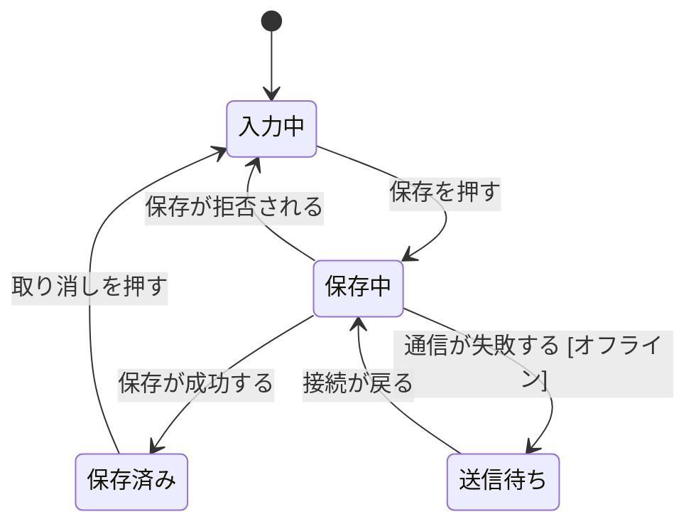

# <フロー名>の状態遷移

<このフローで利用者が何をするか、読み手が何を判断するかを一段落で書く。>

- 状態の正本: `<型・reducer・状態機械のファイルと名前>`
- 最終確認: `<照合したcommit>`

## 図

上の図は形を示す例。実際のフローの状態と遷移に置き換える。

## 規則

| ID | 規則（利用者の文） | 確かめる方法 | 状態 |
|---|---|---|---|
| R1 | <例: 送信待ちがある間は、ログアウトしても記録は消えない> | `<テストのファイルと名前、または機能マップのID>` | 未検証 / 検証済み |

## 状態とコード

| 状態 | 利用者に見えるもの・できること | コードの場所 |
|---|---|---|

## 遷移とコード

| 遷移 | きっかけ | コードの場所 | 検証（機能マップID・テスト） |
|---|---|---|---|

## 所見

<!-- コードにあって図にない遷移、図にあってコードで起きない遷移、到達不能な状態、規則が壊れうる遷移。なければ「なし」 -->

## 図で省いたもの

<!-- まとめた状態、描かなかった遷移とその理由 -->
